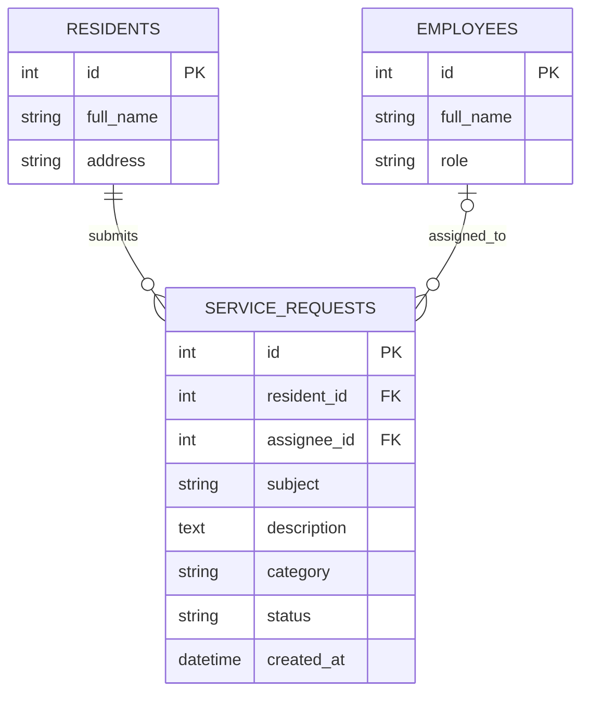

# ORM и миграции для CRM управляющей компании

Лабораторная работа № 4 по дисциплине «Командное проектирование и разработка». Проект хранит заявки жильцов и сведения об исполнителях для аварийно-диспетчерской службы.

## Запуск

Требуется Python 3.10 или новее. Откройте терминал в корне проекта. Команды для Windows PowerShell:

```powershell
python -m venv .venv
.\.venv\Scripts\python.exe -m pip install -r requirements.txt
.\.venv\Scripts\python.exe -m alembic upgrade head
.\.venv\Scripts\python.exe -m alembic current
.\.venv\Scripts\python.exe -m alembic check
.\.venv\Scripts\python.exe -m unittest discover -s tests -v
```

В Linux и macOS используйте `.venv/bin/python` вместо `.\.venv\Scripts\python.exe`.

Миграция `0001` создаёт `crm.db` в корне проекта. Переменная окружения `CRM_DB_PATH` позволяет указать другой файл SQLite. Тесты применяют миграцию к временным базам и используют вымышленные данные.

## Модели и связи



У заявки есть один заявитель. Исполнитель и категория могут отсутствовать при регистрации. Для статусов `assigned` и `closed` исполнитель обязателен. При создании SQLite присваивает заявке статус `accepted` и время регистрации.

Классы `Resident`, `Employee` и `ServiceRequest` хранятся в `app/models`. Модуль `app/database.py` настраивает подключение и включает проверку внешних ключей SQLite.

## Репозиторий заявок

`ServiceRequestRepository` в `app/repositories` принимает сессию SQLAlchemy. Методы `create`, `get`, `list`, `update` и `delete` регистрируют заявку, читают её, фильтруют журнал по статусу, меняют категорию, статус и исполнителя и удаляют запись. Вызывающий код задаёт границы транзакции через `Session.begin()`.

## Миграции

Alembic использует метаданные моделей SQLAlchemy. Для подготовки следующей миграции после изменения моделей запустите `python -m alembic revision --autogenerate -m "describe change"` в активном окружении и проверьте сгенерированный файл перед `python -m alembic upgrade head`.

Команда `python -m alembic downgrade base` удаляет таблицы CRM вместе с записями. Для проверки отката используйте отдельную учебную базу.
